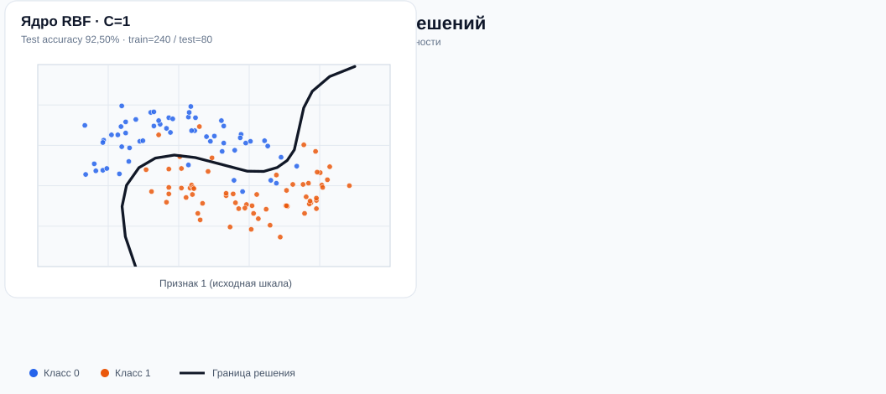
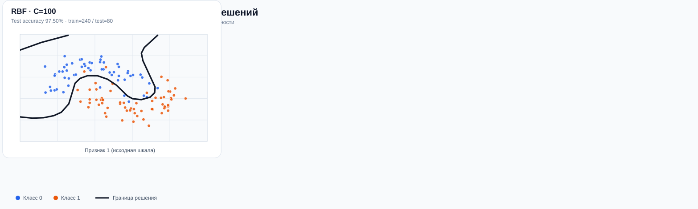

# Практическая работа №9: Метод опорных векторов (SVM)

**Вариант:** Уровень A (шаблон выбран самостоятельно)  
**Репозиторий:** [ibrodevs/ML-P-9](https://github.com/ibrodevs/ML-P-9)  
**Студент:** Иброхим Абдраимов (`ibrodevs`)  
**Группа:** CS-32-24

---

## Цель работы

Исследовать влияние **ядровой функции** (`linear` против `rbf`) и параметра **C** на форму границы решения и качество классификации SVM.

## Обоснование выбора окружения

Для воспроизводимости используется Python 3 и встроенное виртуальное окружение `venv`. В проекте применяются `scikit-learn` (модель, масштабирование и метрики), `numpy`, `matplotlib`, Jupyter Notebook и `pytest`.

## Структура репозитория

```text
ML-P-9/
├── notebooks/
│   └── svm_variant_a.ipynb         # Интерактивная практическая работа
├── src/
│   └── svm_variant_a.py            # Эксперимент и построение PNG-графиков
├── tests/
│   └── test_svm.py                 # Три автоматические проверки
├── results/
│   ├── metrics.json               # Измеренные показатели 4 моделей
│   ├── kernels_comparison.svg     # Сравнение Linear и RBF
│   └── c_effect.svg               # Как изменение C влияет на границу
├── .gitignore
├── README.md
└── requirements.txt
```

## Инструкция по установке и запуску

### 1. Клонирование репозитория

```bash
git clone https://github.com/ibrodevs/ML-P-9.git
cd ML-P-9
```

### 2. Создание виртуального окружения

```bash
# macOS / Linux
python3 -m venv .venv
source .venv/bin/activate

# Windows (PowerShell)
python -m venv .venv
.venv\Scripts\Activate.ps1
```

### 3. Установка зависимостей

```bash
python -m pip install -r requirements.txt
```

### 4. Запуск работы

```bash
# Вариант 1 — открыть учебный ноутбук:
jupyter notebook notebooks/svm_variant_a.ipynb

# Вариант 2 — получить графики и метрики одной командой:
python src/svm_variant_a.py

# Запуск автоматических проверок:
python -m pytest -q
```

После запуска скрипта создаются `results/kernels_comparison.png`, `results/c_effect.png` и обновляется `results/metrics.json`. PNG-файлы исключены из Git для уменьшения размера репозитория.

---

## Краткое описание набора данных

Использован искусственный двумерный набор **`make_moons`** из `sklearn.datasets`.

- Объектов: **320**, признаков: **2**, классов: **2**.
- Шум: `noise=0.22`, воспроизводимость: `random_state=42`.
- Обучающая выборка: **240 объектов** (75%).
- Тестовая выборка: **80 объектов** (25%), стратифицированное разбиение.
- Масштабирование: `make_pipeline(StandardScaler(), SVC(...))`; `StandardScaler` обучается **только на train**, утечки в тест нет.

Форма классов — две пересекающиеся дуги, поэтому набор подходит для проверки нелинейных границ.

## Проведённые эксперименты

1. **Linear SVM:** `SVC(kernel="linear", C=1.0)`.
2. **RBF SVM:** `SVC(kernel="rbf", C=1.0, gamma="scale")`.
3. **Влияние C:** для RBF повторили эксперимент с `C=0.05` и `C=100` при том же `gamma="scale"`.

Метрики рассчитаны **на отложенной тестовой выборке**, которая не использовалась для обучения.

## Результаты

| Модель | Train accuracy | Test accuracy | Test F1 | Опорных векторов |
|---|---:|---:|---:|---:|
| Linear, C=1 | 88,33% | 86,25% | 0,8608 | 78 |
| RBF, C=1 | 90,42% | 92,50% | 0,9250 | 72 |
| RBF, C=0,05 | 88,75% | 87,50% | 0,8750 | 160 |
| **RBF, C=100** | **94,17%** | **97,50%** | **0,9744** | **44** |

### 1. Сравнение ядер при C=1



У линейного SVM граница — прямая. RBF формирует **криволинейную** границу, которая лучше подходит для двух дуг. При одинаковом `C=1` точность RBF выше на **6,25 процентного пункта** (92,50% против 86,25%).

### 2. Влияние параметра C



Уменьшение `C` до 0,05 делает границу более простой и допускает больше ошибок. Повышение `C` до 100 делает границу гибче и увеличивает штраф за ошибки; на этом тесте качество улучшилось до 97,50%. **Это не универсальная закономерность:** излишне высокое `C` может привести к переобучению.

*SVG — компактная иллюстрация на части обучающих точек с границами, вычисленными из обученных SVC; полные графики со всеми точками и опорными векторами создаются и отображаются в ноутбуке.*

---

## Письменные ответы на задания

**Какое ядро лучше разделило данные и почему?** RBF при `C=1` лучше линейного, так как два класса имеют нелинейную форму. Вычисленная на отложенной выборке accuracy равна 0,9250 для RBF и 0,8625 для Linear.

**Как изменилась граница после изменения C?** При `C=0.05` граница сглаживается и ошибок допускается больше; при `C=100` изгибается сильнее под обучающие точки. На данном разбиении точность составила соответственно 0,8750 и 0,9750.

## Вывод

Цель практической работы достигнута: обучены SVM с двумя ядрами, признаки масштабированы, построены границы решений, исследовано влияние `C`, рассчитаны метрики и дано объяснение результатов. Для нелинейных данных `make_moons` **RBF оказался предпочтительнее линейного ядра**. Для надёжного подбора `C` на реальных данных следует использовать кросс-валидацию: представленные цифры относятся к одному фиксированному разбиению.
